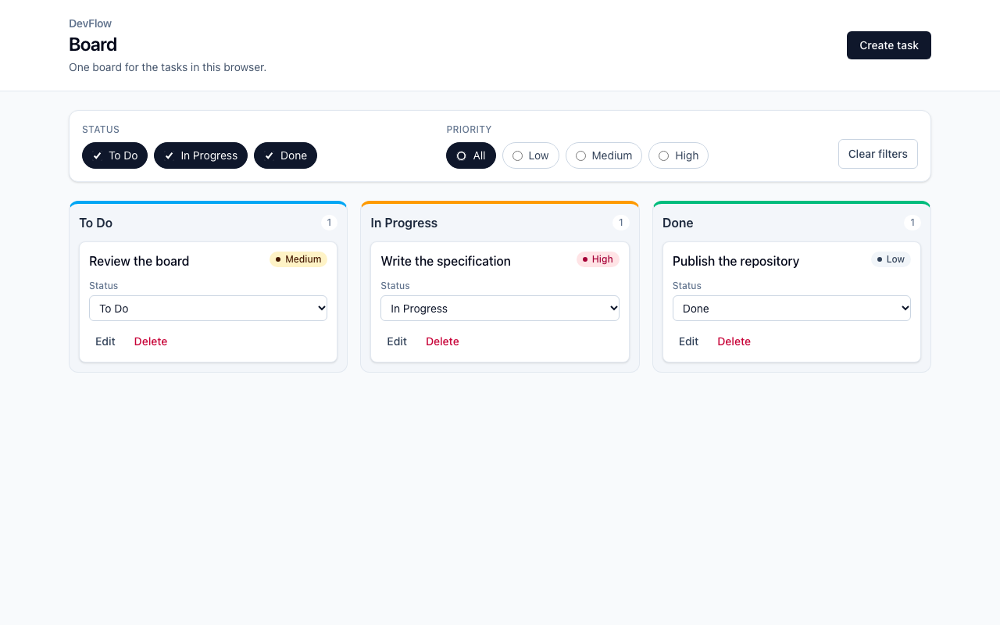
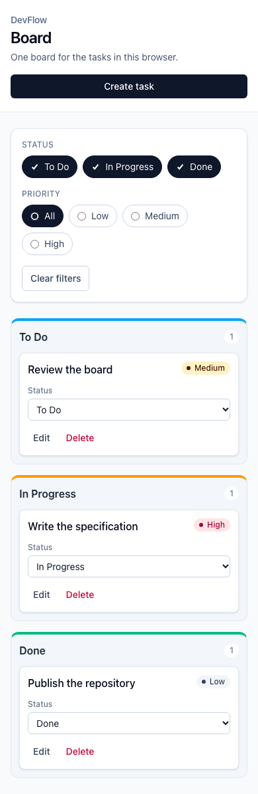

# DevFlow

DevFlow is a project-management application in development. The first feature, task management and a Kanban board, is implemented as a single board stored in this browser. Analytics is not specified. There is no public deployment and no live demo.

## Status

| Area | State |
| --- | --- |
| SvelteKit application shell, TypeScript, Tailwind CSS, Vitest, Playwright | Done |
| Cursor and Claude Code instruction files | Done |
| [DevFlow Constitution](.specify/memory/constitution.md) v1.0.0 | Ratified |
| Spec Kit templates, scripts, and Cursor skills | Present in the repo |
| Task management and Kanban board | Implemented for the approved MVP |
| Analytics | Not specified |
| Public deployment | Not deployed |

## What the board does

The home page is one board for the tasks saved in this browser.

- Create a task with a title, an optional description, a priority of Low, Medium, or High, and a status of To Do, In Progress, or Done.
- See tasks in those three columns. A card shows the title and priority. Opening a task shows the description.
- Edit a task, or leave the edit without saving.
- Move a task with the status control on its card, by keyboard or pointer.
- Delete a task only after confirmation. Cancel leaves it in place.
- Filter by any combination of statuses, including none, and by one priority: All, Low, Medium, or High.
- Keep saved tasks after a refresh. A refresh selects all three statuses and priority All. Unsaved form text is discarded.

A title is required and is at most 200 characters after trimming. A description is optional and is at most 5,000 characters after trimming. Duplicate titles are allowed. The newest task in a column appears first. A status change places that task first in the destination column. An edit that keeps the same status leaves its position unchanged.

## MVP limits

- There is one board. There is no project list, second board, or board switcher.
- Anyone using this browser sees the same tasks. There is no sign-in, account, role, or sharing control.
- Tasks are stored in `localStorage` under `devflow.board.v1`. Another browser or device does not show them.
- A second view in this browser sees a newly saved task after that view is refreshed.
- Moving a task uses the status select. There is no drag-and-drop.
- Corrupt saved data shows "Tasks could not be loaded" and is left unchanged. There is no repair action.
- Analytics is not part of this feature.
- The app is not deployed. `@sveltejs/adapter-auto` has no selected host.

Two success criteria are not claimed as passed. SC-001, creating a task in under one minute, has no timed run. SC-009, the moderated first-use study, has not been run.

## Screenshots

Desktop at 1280×800, then a narrow view at 390×844. Both were captured from the local board in Chromium.





## Technology stack

Versions below are the ones installed in `package-lock.json`. `package.json` declares compatible ranges. Every dependency is a dev dependency, and the package is marked `"private": true`, so it is not an npm library.

| Technology | Installed | Role |
| --- | --- | --- |
| Node.js | 22.17 or newer | Required by `@sveltejs/kit@3.2.0` (`engines.node`) |
| SvelteKit | 3.2.0 | Application framework. Configuration lives in `vite.config.ts`. Shared code is imported as `#lib`. |
| Svelte | 5.57.3 | UI. Runes are enabled for application files. |
| TypeScript | 6.0.3 | `strict` is on in `tsconfig.json`. Checked with `svelte-check`. |
| Vite | 8.3.8 | Dev server and production build |
| Tailwind CSS | 4.3.5 | `@import 'tailwindcss'` in `src/routes/layout.css`, through `@tailwindcss/vite` |
| Vitest | 4.1.12 | Unit tests in Node, component tests in headless Chromium |
| Playwright | 1.65.1 | End-to-end tests |
| `@sveltejs/adapter-auto` | 8.0.1 | Default adapter. No hosting target is selected. |

`npm` is the package manager. `.npmrc` sets `engine-strict=true`. There is no ESLint config, Prettier config, database, authentication package, or deployment config.

## Repository layout

```text
src/routes/+page.svelte          Board page
src/routes/+layout.svelte        Root layout
src/routes/layout.css            Tailwind entry
src/routes/board.e2e.ts          Playwright coverage for the board
src/routes/page.svelte.e2e.ts    Playwright check for the Board heading
src/lib/tasks/                   Domain, storage, board state, and UI
src/lib/vitest-examples/         CLI sample tests, not product behavior
docs/ai-development/WORKFLOW.md  AI development workflow
docs/ai-development/reviews/     Independent review record
.specify/memory/constitution.md  Constitution v1.0.0
.cursor/rules/project-standards.mdc
.cursor/skills/                   Spec Kit skills for Cursor
CLAUDE.md
specs/001-task-kanban-board/     First feature spec, plan, and tasks
```

## AI-assisted engineering

Feature 001 was built with Spec Kit. Cursor implemented the approved task list in the existing SvelteKit application. Claude Code then performed an independent read-only review of that uncommitted implementation. The confirmed delete defect, and the status-select defect found by reproducing the suspected move failure, were fixed with regression tests. A Spec Kit convergence pass compared the result with the specification, plan, and tasks and found no remaining feature gap.

The review record is [docs/ai-development/reviews/001-task-board-review.md](docs/ai-development/reviews/001-task-board-review.md). The process is [docs/ai-development/WORKFLOW.md](docs/ai-development/WORKFLOW.md).

| Tool | Instruction file | Role on this feature |
| --- | --- | --- |
| Cursor | [`.cursor/rules/project-standards.mdc`](.cursor/rules/project-standards.mdc) | Implemented the board from the approved tasks |
| Claude Code | [`CLAUDE.md`](CLAUDE.md) | Independent read-only review against the same standards |
| Spec Kit | [`.specify/`](.specify/) and [`.cursor/skills/`](.cursor/skills/) | Specify, plan, tasks, analyze, implement, and converge |

No MCP servers or automated review bots are configured. The agent workflow does not approve or merge changes by itself.

### Documents for the first feature

| Document | Path |
| --- | --- |
| Constitution v1.0.0 | [`.specify/memory/constitution.md`](.specify/memory/constitution.md) |
| Specification | [`specs/001-task-kanban-board/spec.md`](specs/001-task-kanban-board/spec.md) |
| Requirements checklist | [`specs/001-task-kanban-board/checklists/requirements.md`](specs/001-task-kanban-board/checklists/requirements.md) |
| Implementation plan | [`specs/001-task-kanban-board/plan.md`](specs/001-task-kanban-board/plan.md) |
| Research and decisions | [`specs/001-task-kanban-board/research.md`](specs/001-task-kanban-board/research.md) |
| Data model | [`specs/001-task-kanban-board/data-model.md`](specs/001-task-kanban-board/data-model.md) |
| Persistence contract | [`specs/001-task-kanban-board/contracts/persistence.md`](specs/001-task-kanban-board/contracts/persistence.md) |
| UI contract | [`specs/001-task-kanban-board/contracts/board-ui.md`](specs/001-task-kanban-board/contracts/board-ui.md) |
| Validation guide | [`specs/001-task-kanban-board/quickstart.md`](specs/001-task-kanban-board/quickstart.md) |
| Implementation tasks | [`specs/001-task-kanban-board/tasks.md`](specs/001-task-kanban-board/tasks.md) |
| Independent review | [`docs/ai-development/reviews/001-task-board-review.md`](docs/ai-development/reviews/001-task-board-review.md) |

## Human review

An agent may draft code. A person decides whether it lands.

- Significant work starts from an approved specification and acceptance criteria.
- Agents inspect the existing code and stay inside the current dependencies.
- Agents do not commit, push, merge, deploy, delete files, or install packages unless a person explicitly asks.
- The reviewer compares the diff with the specification and reruns the checks below. Reported results have to come from those commands.

## Local development

Use Node.js 22.17 or newer, then install from the lockfile:

```sh
npm install
```

| Command | What it runs |
| --- | --- |
| `npm run dev` | Vite development server |
| `npm run dev -- --open` | Development server, then open a browser |
| `npm run check` | `svelte-kit sync` and `svelte-check` |
| `npm run check:watch` | The same check, watching for changes |
| `npm run build` | Production build |
| `npm run preview` | Preview the production build |
| `npm run test:unit` | Vitest in watch mode |
| `npm run test:unit -- --run` | Vitest once, then exit |
| `npm run test:e2e` | `playwright install`, then Playwright |
| `npm run test` | Unit tests once, then the end-to-end script |

`npm run test:unit` stays open because the script is `vitest` with no `--run` flag. The first `npm run test:e2e` downloads Playwright browsers. `npm run prepare` runs `svelte-kit sync` on install.

Product behavior is covered by Vitest specs under `src/lib/tasks/` and by `src/routes/board.e2e.ts`. The files in `src/lib/vitest-examples/` remain the original CLI samples.

## Roadmap

1. **Foundation.** Application shell, TypeScript, Tailwind CSS, Vitest, Playwright, Constitution, and agent instruction files. Done.
2. **Spec workflow.** Specify, plan, tasks, analyze, implement, and converge have been run for feature 001.
3. **Board core.** Task management, the Kanban board, priorities, and filters. Implemented for the approved MVP.
4. **Analytics.** A small reporting view of board activity. Not specified.
5. **Portfolio evidence.** Screenshots of the local board are in this file. A live demo waits until a host is chosen. The app is not deployed.

## Live demo

No deployment exists, so there is no demo URL.
